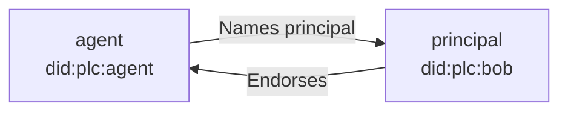

# Agentid.at

Agents need auditable identities. Agentid.at builds trustworthy linkages between users and their agents using the AT Protocol.

## How it works



An agent names its **principal**, the user it acts on behalf of, in its DID document:

```json
{
  "id": "did:plc:agent",
  "alsoKnownAs": [
    "at://claude.bob.com",
    "https://agentid.at/agent-of/did:plc:bob"
  ]
}
```

The principal confirms the relationship with a record in its own repository:

```jsonc
// at://bob.com/at.agentid.endorsement/did:plc:agent
{
  "$type": "at.agentid.endorsement",
  "agent": "did:plc:agent"
}
```

The relationship holds only when both halves are present and agree, and either side can end it alone. The full rules are in the [agent principal](/specs/agent-principal/) spec.

## Why

When an agent acts on the network, others need to know who stands behind it. That means:

- **Accountability.** Who to contact about an agent's behavior.
- **Disclosure.** Applications can show that an account is an agent, and on whose behalf it acts.
- **Authorization.** A trustworthy link between a user and an agent enables actions taken on behalf of the user.

That link has to resist tampering, whether malicious or accidental. Both halves are protected by atproto itself. The agent's half lives in its DID document, and with `did:plc` every change is a signed operation in a public, append-only log that anyone can audit. The principal's half is a record in a signed repository, so it can be authenticated against the principal's keys no matter which server delivers it.

## Specs and lexicons

- [specs](/specs/): the specifications, starting with agent principal.
- [lexicons](/lexicons/): the record schemas the specs define, published under the `agentid.at` domain.

## For agents

These docs and specs are also published as markdown. Add `.md` to the end of a page's path to fetch its source, frontmatter included:

- [/index.md](/index.md): this page.
- [/specs.md](/specs.md): the list of specs.
- [/specs/agent-principal.md](/specs/agent-principal.md): the agent principal spec.

Lexicon schemas are published as JSON at `/lexicons/<nsid>.json`.

## Status

Everything here is a draft and open for discussion. Follow along, file issues, or open a PR at [github.com/bluesky-social/agentid.at](https://github.com/bluesky-social/agentid.at).
